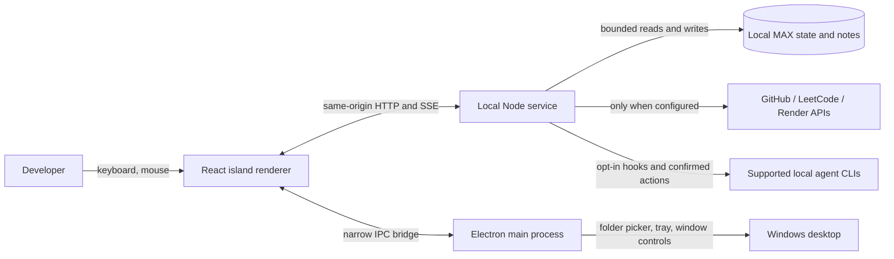

<div align="center">

# MAX

### A calm, local-first desktop companion for the small tasks around your work.

**Open tools. Save thoughts. Stay focused. Pick up where you left off.**

[Windows downloads](https://github.com/ssambit635-svg/MAX/releases) · [Quick start](docs/QUICKSTART-WINDOWS.md) · [QA test plan](docs/QA-TEST-PLAN.md) · [Security](docs/SECURITY.md) · [Report a bug](https://github.com/ssambit635-svg/MAX/issues)


</div>

---

## What MAX is

MAX is a small desktop companion that brings everyday developer actions into one keyboard-friendly place: open an app, save a note, start a focus timer, inspect local project files, and see information from integrations you choose to connect.

MAX is **not** a generative AI, voice assistant, code agent, or replacement for an IDE. It does not call a cloud model. Its command behavior is hand-written and deterministic, so supported actions are explicit rather than improvised.

**Windows is the primary desktop target.** The project also contains macOS and Linux packaging targets; those should be treated as less-tested until verified on those systems.

## A quick visual

The diagram below describes the real interaction model—not a screenshot or product mockup:

```text
       Ctrl / ⌘ + K
             │
             ▼
┌──────────────────────────────┐
│ MAX island                   │
│ palette · notes · focus      │
│ projects · code · sessions   │
└──────────────┬───────────────┘
               │ typed, allowlisted request
               ▼
┌──────────────────────────────┐
│ Local MAX service            │
│ rules · file guards · state  │
└─────┬──────────────────┬─────┘
      │                  │
      ▼                  ▼
Your device         Optional services
notes, settings,    GitHub · LeetCode ·
project paths,      Render · agent CLIs
session metadata    (only when configured)
```

### Screenshots and demo video

This repository does not currently contain verified screenshots or a screen-recording of the running desktop app. I’m intentionally not substituting generated mockups for real product captures. The screenshots/video can be added once captured from a real MAX build; until then, use the [Windows quick start](docs/QUICKSTART-WINDOWS.md) and [QA plan](docs/QA-TEST-PLAN.md) to see and verify the actual flows.

## What you can do

| Workflow | What MAX provides |
| --- | --- |
| **Command palette** | Fuzzy suggestions, keyboard navigation, allowlisted app launches, and a small local history of successful commands. `Ctrl+K` opens it; `Esc` closes it. |
| **Project shortcuts** | Save up to 12 project folder names and paths on this device. In the desktop app, open a shortcut in the file manager; in browser preview, copy its path. These are bookmarks, not full editor/terminal launch configurations. |
| **Notes and capture** | Save Markdown notes, capture a thought or task, search notes, and review a daily digest. |
| **Focus** | Start a focus block or timer and see its status in the island. |
| **Code utilities** | Review supported source files with lightweight rules, scan a bounded project folder, manage snippets, and apply only safe mechanical fixes. This is not a compiler or security auditor. |
| **App actions** | Find available apps, open allowlisted apps, and manage supported custom launchers. MAX does not accept arbitrary shell commands. |
| **Stats** | View local machine and VS Code information, plus GitHub, LeetCode, and Render data when you configure those integrations. Demo data is labeled. |
| **Agent sessions (opt-in / evolving)** | Review lifecycle-hook setup before applying, inspect recent session metadata, and clear MAX's in-memory session list. Confirmed direct replies are enabled only for supported CLI paths; otherwise MAX uses a copy fallback. See the limitations below before enabling hooks. |

## Agent-session safety and current limits

Agent support is still evolving. Hook configuration is provider-specific and has **not** been validated against every real provider version and Windows installation. Keep hook setup opt-in; review the exact preview and backup; use a throwaway profile for early testing. Do not install hooks into a work profile until that provider's configuration and lifecycle behavior have been validated.

Direct replies use documented resume forms for supported Codex and Gemini CLI paths. Claude Code and Cursor Agent remain copy-only until their current CLI contracts are verified. Every reply requires a preview and a separate confirmation; MAX must not simulate terminal keystrokes or approve tool permissions. See [`docs/AGENT-SESSIONS.md`](docs/AGENT-SESSIONS.md) for the implementation contract and [`docs/QA-TEST-PLAN.md`](docs/QA-TEST-PLAN.md) for safe isolated testing.

## Privacy model

- MAX has no account, telemetry, microphone, voice feature, or built-in cloud model.
- Notes, settings, project shortcuts, command history, and session snippets are stored locally. Project shortcuts and palette history use the current browser/app profile; server state is held in MAX's local state directory.
- External integrations make network requests only when you configure/use them. GitHub, LeetCode, and Render data therefore require internet access.
- Agent lifecycle events are sent to the local MAX service using a local token. Session snippets are kept in memory and can be cleared.
- Review the [security notes](docs/SECURITY.md) and [agent-session contract](docs/AGENT-SESSIONS.md) before connecting credentials or changing provider settings.

“Local-first” does not mean every feature is offline: integrations need the network, provider CLIs are separate software, and MAX cannot guarantee how those tools use their own configured permissions.

## Install and try MAX

### Windows: use a CI build artifact

1. Open the repository's [Actions](https://github.com/ssambit635-svg/MAX/actions) page and select a successful **Build MAX** run.
2. Download the Windows installer or portable artifact from that run. Prefer a successful run on the branch/commit you intend to test.
3. Verify the download source and filename. Builds are currently unsigned, so Windows SmartScreen may show a warning. Do not run a file whose source you cannot verify.
4. Install or launch the portable build, then follow [`docs/QUICKSTART-WINDOWS.md`](docs/QUICKSTART-WINDOWS.md).
5. Work through the [practical QA checklist](docs/QA-TEST-PLAN.md) and record blocked tests separately from passes.

The [Releases page](https://github.com/ssambit635-svg/MAX/releases) is the place to look for a published release. Do not assume a release exists just because CI produced an artifact.

### Development setup

Requirements: Node.js 20 or newer and npm. From the repository root:

```bash
cd app
npm ci
npm run dev
```

Open the Vite URL printed by the command for a browser preview. The API runs locally alongside it. The preview is useful for UI work; it cannot validate desktop-only behaviors such as the native project folder picker, tray, global shortcuts, window movement, or installer.

To build and launch the Electron desktop app:

```bash
cd app
npm run desktop
```

To build the web UI only:

```bash
cd app
npm run build
```

## Architecture



- **Renderer:** React + TypeScript island UI, palette, views, and local browser-profile conveniences.
- **Local service:** Node HTTP API, deterministic command routing, file-safe code helpers, optional integrations, and bounded local session registry.
- **Desktop shell:** Electron window, tray, global shortcuts, narrow preload/IPC surface, and desktop folder selection.
- **Persistence:** local JSON state and notes; user-facing paths are configurable. No hosted MAX backend is required for normal desktop use.

## Verification

Run checks from `app/`:

```bash
npm ci
npm run build
npm test
```

`npm test` runs the integration, app resolver, code engine, syntax highlighting, codebase, tool, product, desktop-shell, agent-boundary, and fast production suites. It validates automated behavior; it does **not** replace a manual Windows install/upgrade/agent-provider test. The [QA test plan](docs/QA-TEST-PLAN.md) separates those real-device checks and includes a defect report template.

## Documentation

- [Windows quick start](docs/QUICKSTART-WINDOWS.md) — install and first practical checks.
- [QA test plan](docs/QA-TEST-PLAN.md) — ordered manual acceptance plan and safe AI-assisted triage prompt.
- [Commands](docs/COMMANDS.md) — command reference.
- [Agent sessions](docs/AGENT-SESSIONS.md) — scope, safety boundaries, and launch gates.
- [Security](docs/SECURITY.md) — security and privacy notes.
- [Acceptance checklist](docs/ACCEPTANCE.md) — desktop acceptance expectations.
- [Release guide](docs/RELEASE.md) and [signing notes](docs/SIGNING.md) — packaging and current unsigned-build caveats.

## Contributing

Bug reports are most useful when they include the MAX version, Windows version, test steps, expected behavior, actual behavior, and whether the issue reproduces after restart. **Redact** credentials, usernames, folder names, private project names, and agent text from logs or screenshots before sharing. Never attach provider configuration files that contain secrets.

MAX is a deterministic local companion, not an AI coding agent. Contributions should preserve the product's explicit-action model, local control, bounded file access, and user confirmation for consequential actions.
